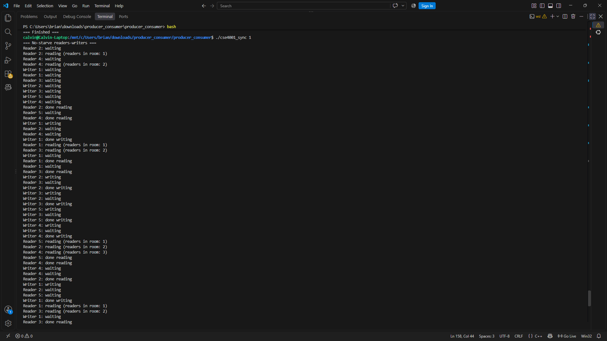
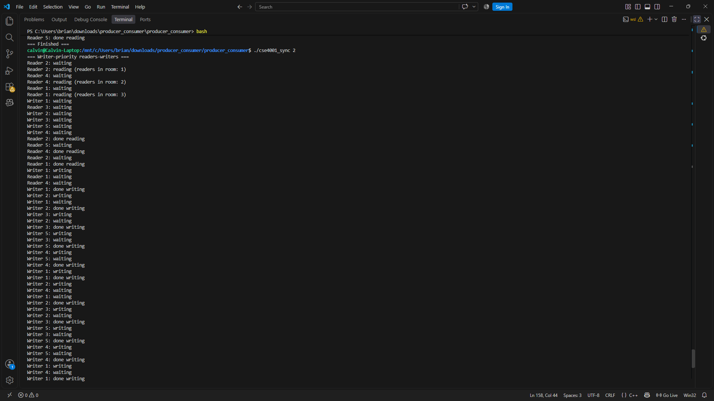
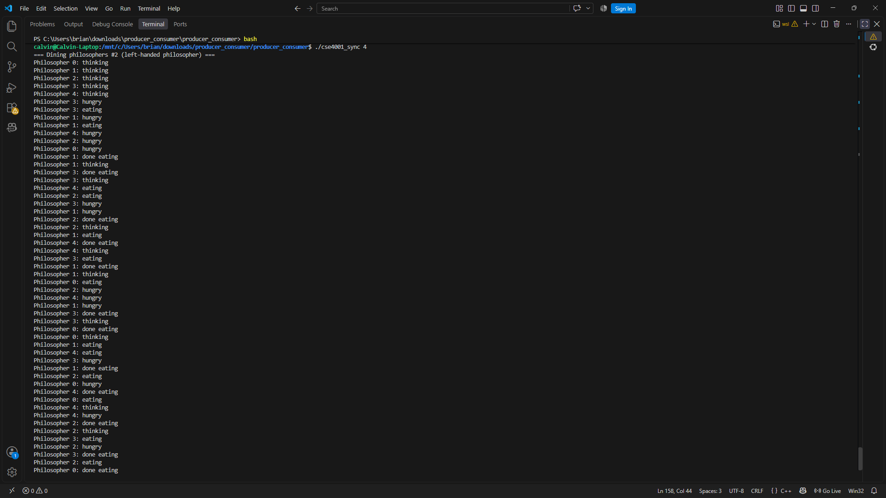

Build and Run
'''
make
./cse4001_sync <problem #>
'''

## Output
### Problem 1: No-starve readers-writers
'./cse4001_sync 1'

### Problem 2: Writer-priority readers-writers
'./cse4001_sync 2'

### Problem 3: Dining Philosophers #1
'./cse4001_sync 3'

### Problem 4: Dining Philosophers #2
'./cse4001_sync 4'

